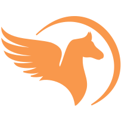

# Pega site
<p align="center">
  
</p>
A partially prerendered SvelteKit website with dynamic content loaded from Firebase and styling with Tailwind and DaisyUI.

- [SvelteKit in 100 seconds](https://youtu.be/H1eEFfAkIik)
- [Tailwind in 100 seconds](https://youtu.be/mr15Xzb1Ook)
- [Firebase in 100 seconds](https://youtu.be/vAoB4VbhRzM)
- [DaisyUI](https://daisyui.com/components/)

## Setup project
### New to web dev
> Steps only required if you are new to web dev(No Node/NPM installed), otherwise skip to [Setup](#Setup)

Install [nvm(Node Version Manager)](https://github.com/nvm-sh/nvm) and [Node.js](https://nodejs.org/en), with the following script:
```bash
winget install --id=CoreyButler.NVMforWindows -e
nvm install 24
nvm use 24
```

### Setup
Copy environment variables from [.env.example](./.env.example) to the `.env` file, and fill in the required variables

Clone project and install dependencies
```bash
git clone https://github.com/TRBLcoding/trbl-website.git
cd trbl-website
npm install
```

Run `npm run dev` to start local server

## TODO
- Combine searchable code into component
